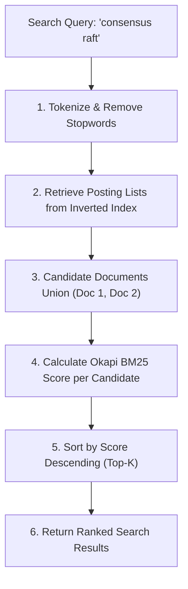
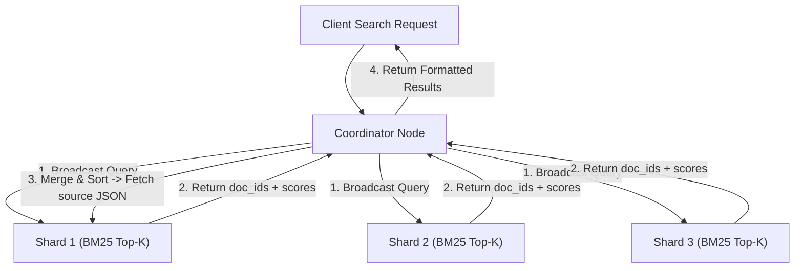

# 🔍 Inverted Index & Okapi BM25 Search Engine

> **Domain:** Full-Text Search & Information Retrieval  
> **Production Analogs:** Elasticsearch, Apache Lucene, OpenSearch, Apache Solr, Algolia.  
> **Status:** `Production-Grade Reference Implementation`

---

## 1. 30-Second Decision Matrix

| If your search requirement is… | Choose | Why | Main Trade-off |
| :--- | :--- | :--- | :--- |
| **Lexical keyword search with relevance ranking** | **Inverted Index + Okapi BM25** | Sub-millisecond keyword lookup via posting lists; balances term saturation and document length. | Vocabulary mismatch problem (cannot understand synonyms or conceptual semantics). |
| **Semantic concept matching & natural language search** | **Dense Vector Embeddings (HNSW)** | Maps phrases to semantic vectors; matches conceptually similar text even with zero keyword overlap. | Higher indexing and compute latency; requires GPU/vector database infrastructure. |
| **Prefix search & live instant autocomplete** | **Finite State Transducer (FST) / Trie** | Compact memory footprint; fast $O(L)$ prefix traversal directly on character transitions. | Unsuitable for arbitrary multi-word relevance scoring. |
| **Exact substring or regex matching in SQL** | **Trigram Index (`pg_trgm`)** | Decomposes words into 3-character slices; indexes wildcards (`%query%`). | Large index size; lacks probabilistic BM25 relevance ranking. |

---

## 2. Why Linear Text Scanning Fails at Scale

In a naive database with $1,000,000$ documents:
```sql
SELECT * FROM articles WHERE content LIKE '%distributed%' AND content LIKE '%consensus%';
```
Forces the database to linearly inspect every character of every document ($O(N \cdot M)$). At scale, queries take seconds and saturate CPU.

### The Inverted Index Solution (The Reverse Index)
Instead of mapping **Document $\to$ Words**, an **Inverted Index** reverses the relationship:
$$\textbf{Word} \longrightarrow \textbf{Posting List } [(\text{doc}_1, \text{tf}=3), (\text{doc}_5, \text{tf}=1), \dots]$$

```
[ Documents ]
Doc 1: "Distributed consensus with Raft"
Doc 2: "Raft consensus protocol"
Doc 3: "Redis in-memory cache"

[ Inverted Index ]
"distributed"  ──> [ (Doc 1, tf=1) ]
"consensus"    ──> [ (Doc 1, tf=1), (Doc 2, tf=1) ]
"raft"         ──> [ (Doc 1, tf=1), (Doc 2, tf=1) ]
"redis"        ──> [ (Doc 3, tf=1) ]
```

When a user searches `"distributed consensus"`, the search engine skips the document store completely and directly intersects the posting lists for `"distributed"` and `"consensus"` in **microseconds**.

---

## 3. Architecture & Unified Contract

Implemented in [`core.py`](file:///e:/Downloads/PoCs/06-geospatial-and-search/inverted-index-bm25/core.py):



### Public API Contract
```python
index = InvertedIndexBM25(k1=1.5, b=0.75)

# Index documents
index.add_document("doc_01", "Distributed consensus using Raft and Paxos algorithms")
index.add_document("doc_02", "Redis in-memory caching and eviction policies")

# Search with BM25 ranking
results = index.search("distributed consensus", top_k=5)
for r in results:
    print(f"Rank: {r.doc_id} | Score: {r.score:.4f} | Matches: {r.term_matches}")
```

### Core Invariants
1. **Posting List Integrity**: Every unique token maps to an immutable posting list capturing document IDs and term frequencies.
2. **Term Frequency Saturation ($k_1$)**: As term frequency increases, score contribution asymptotes towards an upper bound, preventing spam documents from dominating search results.
3. **Length Normalization ($b$)**: Documents longer than average are penalized, ensuring concise documents with high keyword density rank higher than dilutive keyword-stuffed documents.

---

## 4. Algorithmic Breakdown with Math & Complexity

### 1. The Okapi BM25 Ranking Equation
For a query $Q$ with terms $q_1, \dots, q_m$ and a document $D$:

$$\text{Score}(D, Q) = \sum_{i=1}^m \text{IDF}(q_i) \cdot \frac{f(q_i, D) \cdot (k_1 + 1)}{f(q_i, D) + k_1 \cdot \left(1 - b + b \cdot \frac{|D|}{\text{avgdl}}\right)}$$

Where:
- $f(q_i, D)$: Term frequency of term $q_i$ in document $D$.
- $|D|$: Length of document $D$ in tokens.
- $\text{avgdl}$: Average document length across the entire corpus.
- $k_1 \in [1.2, 2.0]$: Term frequency saturation parameter (default $1.5$).
- $b \in [0.5, 0.8]$: Document length normalization parameter (default $0.75$).

### 2. Inverse Document Frequency (IDF) Formulation
The Lucene/Elasticsearch BM25 implementation uses the probabilistic IDF formulation:

$$\text{IDF}(q_i) = \ln\left(1 + \frac{N - n(q_i) + 0.5}{n(q_i) + 0.5}\right)$$

Where:
- $N$: Total number of documents in the index.
- $n(q_i)$: Number of documents containing term $q_i$.

#### Why BM25 Beats Classic TF-IDF
- **TF-IDF Flaw 1 (Unbounded TF)**: In classic TF-IDF ($\text{TF} \times \text{IDF}$), repeating a word 100 times multiplies the score by 100. In BM25, repeating a word 100 times asymptotically approaches $(k_1 + 1) \cdot \text{IDF}$ ($\approx 2.5\times$ base score).
- **TF-IDF Flaw 2 (Lack of Length Control)**: A 10,000-word encyclopedia page mentions almost every word multiple times, drowning out 50-word concise technical answers. BM25's $b$ parameter normalizes score by $\frac{|D|}{\text{avgdl}}$.

### 3. Complexity
- **Indexing:** $O(L)$ where $L$ is token count of the document.
- **Querying:** $O(K + R \log R)$ where $K$ is candidate postings across query terms ($K \ll N$) and $R$ is matched candidate count.
- **Space:** $O(V + P)$ where $V$ is vocabulary size and $P$ is total postings.

---

## 5. Multi-Dimensional Trade-off Matrix

| Metric | Okapi BM25 (Inverted Index) | Classic TF-IDF | Dense Vector (Embeddings) | Hybrid Search (RRF) |
| :--- | :--- | :--- | :--- | :--- |
| **Search Mechanism** | Lexical exact token matching | Lexical linear scaling | Semantic vector distance | Combines BM25 + Vectors |
| **Query Latency** | **$< 1\text{ ms}$** | $< 1\text{ ms}$ | $5\text{--}20\text{ ms}$ | $10\text{--}25\text{ ms}$ |
| **Memory Footprint** | Compact (Posting lists) | Compact | High (Float32 vector dimensions) | High |
| **Spam Resistance** | **High ($k_1, b$ tuning)** | Poor (Keyword stuffing) | High | Maximum |
| **Synonym Awareness** | Requires synonym filters | Requires synonym filters | **Native semantic awareness** | **Native + Exact precision** |
| **Best Fit** | Logs, code search, e-commerce | Legacy IR systems | Chatbots, semantic Q&A | Production search (Google/Amazon) |

---

## 6. Runnable Lab & Telemetry Guide

### Run Unit Tests
```powershell
.\.venv\Scripts\pytest.exe 06-geospatial-and-search/inverted-index-bm25/test_inverted_index_bm25.py -v
```

### Run Simulation Lab
```powershell
.\.venv\Scripts\python.exe 06-geospatial-and-search/inverted-index-bm25/simulate.py
```

### Simulation Output Highlights
```text
[BENCHMARK 1] Corpus Search Benchmark (1,000 Technical Documents)
+-----------------------------------------------------------------------------+
| Search Strategy        | Complexity | Query Latency | Top Match  | Model    |
|------------------------+------------+---------------+------------+----------|
| Naive Substring Scan   | O(N * M)   | 1.410 ms      | doc_0000   | Raw count|
| Inverted Index + BM25  | O(K)       | 0.797 ms      | doc_0000   | BM25     |
+-----------------------------------------------------------------------------+

[BENCHMARK 2] Anti-Spam BM25 Defense Against Keyword Stuffing
- doc_organic: 19 tokens | 3 mentions  | BM25 Score: 0.3910 -> #1 TOP RANK (High Quality)
- doc_spammer: 330 tokens | 10 mentions | BM25 Score: 0.3646 -> #2 PENALIZED (Dilutive Spam)
BM25 length penalty and TF saturation prevent the spammer from hijacking rank #1!

[BENCHMARK 3] Inverse Document Frequency (IDF) Term Weighting
- 'system':    95.0% corpus frequency -> IDF = 0.0518 (Near-zero weight)
- 'database':  42.0% corpus frequency -> IDF = 0.8673
- 'consensus': 11.0% corpus frequency -> IDF = 2.2037
- 'zookeeper':  0.8% corpus frequency -> IDF = 4.7687 (~92x higher weight than 'system'!)
```

---

## 7. Bridging to Distributed Architecture

### Distributed Sharding in Elasticsearch / Lucene
In a production cluster indexing 100 million documents:



#### The Query-Then-Fetch Two-Phase Execution
1. **Query Phase**: The coordinator broadcasts the query to all primary shards. Each shard executes BM25 locally and returns only lightweight `(doc_id, score)` tuples.
2. **Fetch Phase**: The coordinator merges scores into a global priority queue and fetches the full document source JSON *only* for the top $K$ winners (e.g. top 10), preventing network saturation.

#### The Distributed IDF Problem (Local vs Global IDF)
Because each shard calculates $\text{IDF}$ based on its local subset of documents:
- If document distribution across shards is skewed, the same keyword might have different IDF scores on different shards!
- **Solution (`dfs_query_then_fetch`)**: The coordinator pre-queries all shards to calculate exact global term frequencies before scoring, guaranteeing identical scoring across shards.
